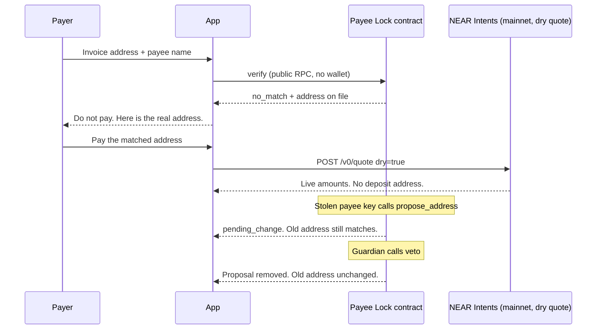

# Payee Lock

Confirm who you are paying before crypto leaves. Payee Lock is an open registry on NEAR: a named account publishes the addresses where it wants to be paid, and a change to those addresses does nothing until a public delay has passed.

This is a NEAR HACKATHON project (development ends 2026-11-14 23:59 UTC). The chain is NEAR testnet. Nothing here holds real funds.

## Hosted demo

No install. The site stays up through judging (18 November 2026, and ideally through 25 November).

- App: https://payee-lock.vercel.app
- Demo: https://payee-lock.vercel.app/demo

1. Payee Acme, chain Ethereum. Paste `0x4e8fa91c0d4e77b2c61890ab44f13c8e06e35d17` and check. See **Do not pay**, plus a lookalike warning (first 4 and last 6 characters match the address on file).
2. Paste `0x4e8f1c2a9b7d6e5c3a18f0d4b27c91aa06e35d17` and check. See **Match**: this is Acme Treasury's real Ethereum address.
3. Click **Get a live quote**. If Intents answers, see its live amounts and a label that execution is simulated. If it does not answer within about 12 seconds, the page says "NEAR Intents didn't respond in time. Try again." and shows a retry button. It does not invent amounts or spin forever.
4. Open `/demo`, choose **Propose the address swap**, and see a 3 minute countdown. During that window the old Ethereum address still matches. Then **Veto with the guardian key**. See the proposal removed.

Curl examples and `scripts/agent-verify.mjs` are in [Try it](#try-it).

## The problem

UK, EU, Australian, and New Zealand banks run Confirmation of Payee: before money moves, the payer is told whether the account name matches the account they typed. The UK Payment Systems Regulator, citing Pay.UK, reports a **59% reduction in Faster Payments claims for payments sent to the wrong account** since Confirmation of Payee launched, and a 20–40% reduction in losses for some fraud types ([PSR CP26/2, July 2026](https://www.psr.org.uk/media/ugtogbad/cp26-2-extending-specific-direction-17-july-2026.pdf)).

Crypto has no equivalent. A transfer to a wrong address is final.

- **Address poisoning.** Tsuchiya, Dong, Soska, and Christin measured Ethereum and BNB Smart Chain from July 2022 through June 2024 and found about **270 million** poisoning attempts against **17 million** addresses, with **6,633** incidents and **at least $83.8 million** stolen ([USENIX Security 2025](https://www.usenix.org/conference/usenixsecurity25/presentation/tsuchiya)). The attack copies the first and last characters of a real address and changes the middle, because wallets hide the middle.
- **A single loss.** On 19–20 December 2025 a user lost **49,999,950 USDT** after a dust transaction planted a lookalike address in their history ([CoinDesk, 20 Dec 2025](https://www.coindesk.com/web3/2025/12/20/crypto-user-loses-usd50-million-in-address-poisoning-scam)).
- **Invoice and email swaps.** A business email or invoice replaces the payee's address. The payer sends to the attacker. There is no bank-style name check to stop it, and no delay if the payee's own published address is later swapped.

## What it does

1. A NEAR account registers the addresses where it receives funds, per chain (NEAR, Ethereum and other EVM chains, Solana, Bitcoin).
2. Anyone can ask `verify(payee, chain, address)`. The answer is `match`, `no_match`, `pending_change`, or `not_registered`.
3. The first addresses are active immediately. Every later change is public and inert for a delay. The previous address stays the one that matches until the delay ends.
4. The payee, or a guardian the payee cannot remove, can veto during the window.
5. The web app flags a lookalike: an address that shares the first and last 4–6 characters with the registered one and differs in the middle.
6. A matched Ethereum address can be quoted for payment from another chain through NEAR Intents. The quote is live. Sending funds is simulated and labeled as such, because Intents has no testnet.



## NEAR features, and why

| Feature | Where | Why it is the right tool |
| --- | --- | --- |
| Named accounts | Payees are accounts such as `acme.plock5dfa73.testnet` | The thing you check is a name, not a 40-character hex string someone pasted into an email. |
| Contract-enforced delay | `propose_address` stores `activates_at_ms`. `verify` ignores the proposal until `env::block_timestamp()` passes it. | A stolen key cannot silently retarget payments. The old address stays authoritative, and the window is enforced by the contract, not by the website. |
| Guardian the owner cannot dismiss | `set_guardian` lets the payee appoint a guardian once. After that only the guardian can rotate it. There is no clear. | The key that publishes a swap must not be the key that can delete the veto. |
| One account, many chains | Addresses are stored per chain on the same NEAR account | The payee identity is the NEAR account. Ethereum, Solana, and Bitcoin addresses hang off it. Chain signatures (NEAR's MPC signer) are the way that account would later *sign* on those chains. This registry records the addresses and time-locks changes. It does not call the MPC contract. |
| NEAR Intents | `POST /api/quote` calls the public [1Click API](https://docs.near-intents.org/) with `dry: true` | After a match, the payer can settle from another chain or token to the verified address. Intents has no testnet ([hackathon Q-007](https://nearhackathon.com/HACKATHON.md)), so execution is not attempted. |
| Events | NEP-297 `EVENT_JSON` logs plus an on-contract activity log | Proposals, vetoes, and activations are public. The profile page reads the log with a view call. No indexer is required. |

The contract is Rust and `near-sdk` 5.30.1. Methods use `snake_case`. Views are free and need no account. `register` requires 0.02 NEAR attached so the contract can cover the new state.

**Deployed contract:** [`plock5dfa73.testnet`](https://testnet.nearblocks.io/address/plock5dfa73.testnet)

Initialized with a **60 second** minimum delay so the window is visible. `get_config` also returns the production recommendation: **259200 seconds (72 hours)**. A mainnet deployment should `init` with that floor. The three demo payees register with a **180 second** delay so a person can watch the countdown and still veto.

| Payee | Account | Ethereum address that verifies |
| --- | --- | --- |
| Acme Treasury | `acme.plock5dfa73.testnet` | `0x4e8f1c2a9b7d6e5c3a18f0d4b27c91aa06e35d17` |
| Globex Payments | `globex.plock5dfa73.testnet` | `0x91c4b7e0a25d48f13c6aa0917e5d44b0c8f12a6d` |
| Initech Payroll | `initech.plock5dfa73.testnet` | `0x0d5e2a77c1b948e36f0a14d2c7bb9051e8a3c64f` |

Guardian for all three: `guardian.plock5dfa73.testnet`.

Poisoned invoice address (not registered): `0x4e8fa91c0d4e77b2c61890ab44f13c8e06e35d17`. It copies the first 4 and last 8 hex characters of Acme's address.

## Try it

Do this, and you should see that.

### Hosted demo (no install)

The site stays up through judging (18 November 2026, and ideally through 25 November): [https://payee-lock.vercel.app](https://payee-lock.vercel.app) and [https://payee-lock.vercel.app/demo](https://payee-lock.vercel.app/demo).

1. Set the payee to Acme and the chain to Ethereum. Paste `0x4e8fa91c0d4e77b2c61890ab44f13c8e06e35d17` and click **Check this address**. See **Do not pay** ("This does not belong to Acme Treasury") and a lookalike warning. The warning reports the first 4 and last 6 characters.
2. Paste `0x4e8f1c2a9b7d6e5c3a18f0d4b27c91aa06e35d17` and check again. See **Match** ("This is Acme Treasury's real Ethereum address").
3. Click **Get a live quote**. The app calls `https://1click.chaindefuser.com/v0/quote` with `dry: true` for 10 USDC on NEAR, paid out as USDC on Ethereum to the address that currently matches. It does not send funds. If Intents returns a quote, the amounts on the page are those amounts and execution is labeled simulated. Each attempt waits at most about 12 seconds, then retries once. If both fail, the page says "NEAR Intents didn't respond in time. Try again." and offers **Try again**. It does not invent amounts.
4. Open https://payee-lock.vercel.app/demo. Click **Propose the address swap**. See a countdown of 3 minutes (the payee's delay is 180 seconds). While it is counting, a check of `0x4e8f1c2a9b7d6e5c3a18f0d4b27c91aa06e35d17` still returns match, and the poisoned address is `pending_change`. Click **Veto with the guardian key**. See the proposal removed: the poisoned address is `no_match` again and the address on file is unchanged.

These reads were checked against the hosted API:

```bash
curl -sS "https://payee-lock.vercel.app/api/verify?payee=acme&chain=ethereum&address=0x4e8fa91c0d4e77b2c61890ab44f13c8e06e35d17"
# status: no_match, lookalike prefix 4, suffix 6

curl -sS "https://payee-lock.vercel.app/api/verify?payee=acme&chain=ethereum&address=0x4e8f1c2a9b7d6e5c3a18f0d4b27c91aa06e35d17"
# status: match
```

`PAYEE_LOCK_URL=https://payee-lock.vercel.app` works with the agent script (the script still runs on your machine; it calls the hosted API):

```bash
PAYEE_LOCK_URL=https://payee-lock.vercel.app node scripts/agent-verify.mjs --payee acme --chain ethereum --address 0x4e8fa91c0d4e77b2c61890ab44f13c8e06e35d17
# exit 2: Refusing to pay

PAYEE_LOCK_URL=https://payee-lock.vercel.app node scripts/agent-verify.mjs --payee acme --chain ethereum --address 0x4e8f1c2a9b7d6e5c3a18f0d4b27c91aa06e35d17
# exit 0: Payee confirmed
```

Propose and veto on the hosted demo are real testnet transactions. They were checked on 10 November 2026 (propose `8fe6HVrFMhR2gMtd1YBrEHA1n6fbQsK3pfmiS3oj8bS3`, veto `1bMRcLRL8hw2QxUPUzcAmcTa7JrB4ufR85ArLsKrQLm`). The registry was left with no pending change.

### Run it yourself

```bash
npm install
npm run dev
```

Open http://localhost:3000.

1. Click **Fill the poisoned example**, then **Check this address**.
   See a red **Do not pay** result: "This does not belong to Acme Treasury", the invoice address and the address on file side by side, and a lookalike warning.
2. Replace the address with `0x4e8f1c2a9b7d6e5c3a18f0d4b27c91aa06e35d17` and check again.
   See a green **Match**: "This is Acme Treasury's real Ethereum address", then a payment panel.
3. Click **Get a live quote**.
   See live NEAR Intents amounts and a banner that execution is simulated, or, if Intents is slow, "NEAR Intents didn't respond in time. Try again." with a retry button. **Execute swap** does not send funds.
4. Open **Acme** in the header.
   See one address per chain, no pending change, and the registration in the activity log.

The same check over HTTP, which is what an agent should call before paying:

```bash
curl -sS "http://localhost:3000/api/verify?payee=acme&chain=ethereum&address=0x4e8fa91c0d4e77b2c61890ab44f13c8e06e35d17"
# status: no_match, plus lookalike

curl -sS "http://localhost:3000/api/verify?payee=acme&chain=ethereum&address=0x4e8f1c2a9b7d6e5c3a18f0d4b27c91aa06e35d17"
# status: match

node scripts/agent-verify.mjs --payee acme --chain ethereum --address 0x4e8fa91c0d4e77b2c61890ab44f13c8e06e35d17
# prints the JSON and exits 2: Refusing to pay

node scripts/agent-verify.mjs --payee acme --chain ethereum --address 0x4e8f1c2a9b7d6e5c3a18f0d4b27c91aa06e35d17
# exits 0: Payee confirmed
```

`/api/quote` refuses to quote unless `verify` currently returns `match` for that payee's Ethereum address. A poisoned address cannot be slipped into the payment step.

### Contract tests

```bash
# rustup update stable && rustup target add wasm32-unknown-unknown
npm run test:contract
```

See `17 passed`. The tests cover match and no-match, the delay (old address still matches one nanosecond before activation, the new address matches at the deadline), veto by the guardian and by the owner, rejection of a stranger, rejection of a second proposal while one is pending, guardian rotation, and the events.

```bash
npm run test:lookalike
```

See 4 passed. That check runs in the app, not in the contract: the contract stores exact addresses.

### Full demo, including propose and veto

Reads work against the deployment above. Writes need demo keys on the server. There is no wallet button. The server signs with testnet accounts.

```bash
# Installs, if you do not have them:
# curl --proto '=https' --tlsv1.2 -LsSf https://github.com/near/near-cli-rs/releases/latest/download/near-cli-rs-installer.sh | sh
npm run seed
npm run dev
```

`npm run seed` uses `near-cli-rs` `sponsor-by-faucet-service` to create a contract account when you do not already have one, funds subaccounts from that balance, builds the wasm if needed, deploys, registers Acme, Globex, and Initech, and writes `.env.local`. It does not print the keys. Restart `npm run dev` after seeding so Next.js loads the new env file.

If `config/deployed.json` already points at `plock5dfa73.testnet` and you do not have that account's key, set a fresh name and seed your own deployment:

```bash
CONTRACT_ACCOUNT_ID=your-name.testnet npm run seed
```

Then open http://localhost:3000/demo and click through. Each chain step is a real testnet transaction.

## 60-second video

Record http://localhost:3000/demo. Do not wait out the timer. Veto while it is counting.

1. **Invoice** (about 8 seconds). The email from accounts@acme.example asks for 10 USDC and shows the poisoned address, with the copied head and tail marked.
2. **Check this address** (about 12 seconds). Red stamp, "This does not belong to Acme Treasury", the real address beside it.
3. **Pay the real address** (about 15 seconds). Get a live quote. Point at the simulated-execution banner. Click Execute swap and show that nothing is sent.
4. **Propose the address swap** (about 15 seconds). The button signs with Acme's key, standing in for a stolen owner key. The profile state shows the proposal as pending, with a countdown. Say that the old address still verifies.
5. **Veto with the guardian key** (about 10 seconds). The poisoned address comes back as no match. Open the profile and show the veto in the activity log.

Suggested post text, for the human to publish (do not post it for them):

> Crypto still lets you pay a lookalike address. Banks got a 59% drop in misdirected payments after Confirmation of Payee. Payee Lock puts that check on NEAR: a public delay before a payee's address can change, and a guardian who can veto it. Built at NEAR HACKATHON. @NEARProtocol #NEARHackathon

## Tracks

One project, three tracks:

- **`security` — AI Security & Defense.** The registry is a policy an agent can check before it pays (`/api/verify` and `scripts/agent-verify.mjs`). A stolen payee key can propose a swap and cannot delete the guardian. Lookalike detection catches the poisoning pattern.
- **`realworld` — Real-World Money.** The user is a company paying an invoice. The payee is a name. The result is "this is Acme's address" or "this is not".
- **`defi` — Unstoppable DeFi.** After a match, NEAR Intents quotes a cross-chain payment to that address. No custodian holds the invoice. The quote path is the public 1Click API.

## Run and deploy

### Local

Requirements: Node.js 22 or newer, Rust stable (near-sdk 5.30 needs a recent stable; 1.99 works), the `wasm32-unknown-unknown` target, and [near-cli-rs](https://docs.near.org/tools/cli) if you run `npm run seed`.

```bash
npm install
npm run test:contract
npm run dev
```

App: http://localhost:3000. Contract calls from the app use `https://test.rpc.fastnear.com` unless `NEAR_RPC_URL` is set.

### Environment

Copy `.env.example` to `.env.local`. `npm run seed` fills the secrets. Do not commit `.env.local`.

| Variable | Required for | Purpose |
| --- | --- | --- |
| `CONTRACT_ID` | Reads, if you are not using the committed config | Contract account. Committed default: `plock5dfa73.testnet`. |
| `NEAR_RPC_URL` | Optional | Public testnet RPC. Default `https://test.rpc.fastnear.com`. |
| `ACME_ACCOUNT_ID`, `ACME_PRIVATE_KEY` | Propose and register for Acme | Same pair for `GLOBEX_*` and `INITECH_*`. |
| `GUARDIAN_ACCOUNT_ID`, `GUARDIAN_PRIVATE_KEY` | Veto and settle | Separate from the payee keys. |
| `INTENTS_JWT` | Optional | Partner JWT from https://partners.near-intents.org. Dry quotes work without it and pay the unauthenticated fee. |
| `INTENTS_API_URL` | Optional | Default `https://1click.chaindefuser.com`. |
| `PAYEE_LOCK_URL` | Optional | Base URL for `scripts/agent-verify.mjs`. Default `http://localhost:3000`. |

The write routes only sign for those three payee accounts and the guardian. They do not accept an arbitrary account id or an arbitrary method. They are still a demo relayer: anyone who can reach the server can spend the demo accounts' testnet gas. Do not put mainnet keys in them.

The contract account's full-access key stays in the near-cli legacy keychain (`~/.near-credentials/testnet/<account>.json`). Seed uses it to deploy and to create subaccounts. It is not copied into `.env.local`.

### Vercel

The site is a Next.js app at the repository root. No adapter and no wallet package.

1. Import the GitHub repository. Framework preset: Next.js. Root directory: the repository root.
2. Deploy. Reads work with no environment variables, because `config/deployed.json` names `plock5dfa73.testnet` and the public RPC.
3. To enable propose and veto on the hosted demo, add the variables from `.env.local` in the Vercel project settings and redeploy. Keep the site up through judging (18 November 2026, ideally 25 November).

`next build` is the production build. It completes with the pages `/`, `/demo`, `/payee/[account]`, and the `/api/*` routes.

## What is real, and what is simulated

| Action | Real? |
| --- | --- |
| Contract on NEAR testnet, including register, verify, propose, veto, settle | Real. `plock5dfa73.testnet`. |
| View calls from the app and from `/api/verify` | Real public RPC. No wallet. |
| Propose and veto in the demo | Real transactions, signed on the server with the demo keys. |
| Lookalike warning | Real comparison in the app. Not stored on chain. |
| Intents quote (`dry: true`) | Real HTTP call to the public 1Click API. Amounts, correlation id, and signature are the API's. |
| Intents execution | **Simulated.** The UI says so. `dry: true` does not create a deposit address and this demo never sends funds. Intents has no testnet. |
| The invoice email | A prop. The address in it is the poisoned example above. |

If the quote request fails or times out, the page says so and does not invent amounts. A slow Intents call is cut off after about 12 seconds, with one retry.

## API

`GET /api/verify?payee=&chain=&address=`

`payee` is an account id (`acme.plock5dfa73.testnet`) or a display name / first label (`acme`). `chain` is `near`, `ethereum` (`eth` and `evm` too), `base`, `arbitrum`, `polygon`, `solana`, or `bitcoin`.

`GET /api/payee?account=` · `GET /api/payees` · `GET /api/activity?payee=&limit=`

`POST /api/quote` with `{ "payee": "acme", "origin": "near-usdc" }` or `"origin": "ethereum"`. Quotes 10 USDC from NEAR, or 0.01 ETH from Ethereum, delivered as USDC on Ethereum to the address that currently verifies.

`POST /api/tx` with `{ "action": "propose" | "veto" | "settle" | "register", ... }`. Needs the env keys. `propose` signs as the payee. `veto` signs as the guardian.

## Contract

Source: `contract/src/lib.rs`. Build:

```bash
cargo build --manifest-path contract/Cargo.toml --release --target wasm32-unknown-unknown
# wasm: contract/target/wasm32-unknown-unknown/release/payee_lock.wasm
```

| Method | Who | Effect |
| --- | --- | --- |
| `init(min_delay_seconds)` | Deployer, once | Sets the delay floor. This deployment used `60`. Use `259200` in production. |
| `register(display_name, guardian, delay_seconds, addresses)` | The payee account | Pays 0.02 NEAR. Initial addresses are active immediately. |
| `propose_address(chain, new_address)` | The payee account | Opens one pending change. Rejected while another is pending, or if the address is unchanged. |
| `veto(payee, chain)` | Payee or guardian | Removes a change whose delay has not elapsed. After the delay it fails, because the change is already effective. |
| `settle(payee, chain)` | Anyone | Writes a due change and emits `address_activated`. |
| `set_guardian(payee, guardian)` | Payee if none yet, otherwise the current guardian | Cannot clear the guardian. |
| `verify`, `get_payee`, `get_payees`, `find_payee`, `get_activity`, `get_config` | Anyone | Views. A due change already counts in `verify` before `settle` is called. |

Events, as `EVENT_JSON` with standard `payee-lock` and version `1.0.0`: `payee_registered`, `address_proposed`, `address_vetoed`, `address_activated`, `guardian_set`.

## Built with

Built during the hackathon window, which runs through 2026-11-14 23:59 UTC. Most of the code was written with AI coding assistance. The first commit in the repository is a one-line README. There is no earlier product.

From `package.json` and `contract/Cargo.toml`:

- Next.js 15 (`next` ^15.5.4) and React 19 (`react` and `react-dom` ^19.1.1)
- `near-api-js` 7.4.0, for server-side signing
- TypeScript (`typescript` ^5.9.2)
- `near-sdk` 5.30.1, for the Rust contract

`scripts/seed.mjs` also calls `near-cli-rs` (0.31.1 when the testnet account was created). The quote route calls the NEAR Intents 1Click API at `https://1click.chaindefuser.com`.

## Limitations and what should come next

- This deployment's delay floor is 60 seconds, and the demo payees use 180 seconds, so a video can show the countdown. A production `init` should use 72 hours. The contract enforces whatever floor it was given. It does not hard-code 72 hours.
- An attacker who keeps the payee key can propose again after every veto. A later version wants a cooldown or a rising delay.
- Address checks are format checks. They do not verify an EIP-55 checksum, a bech32 checksum, or that a Solana address decodes to 32 bytes.
- The guardian is one account. A production payee would point that role at a multisig (this track's hint is not to rebuild one).
- Storage is a flat 0.02 NEAR on register, not a NEP-145 market. The activity log keeps the latest 100 events on the contract.
- The demo server holds full-access keys for the demo accounts. A production payee signs from their own account, or with a function-call key scoped to `propose_address`. The guardian key should not sit on a public web server.
- Chain signatures are the intended way for the NEAR account to sign on the other chains. They are not integrated here.
- Intents execution is simulated. A mainnet version would request `dry: false`, show the deposit address, and let the payer send. It would still refuse to quote an address `verify` does not match.
- Lookalike detection lives in the app. A wallet or agent can ignore it and call `verify` alone, which is an exact check.

## License

MIT. See [LICENSE](LICENSE).
